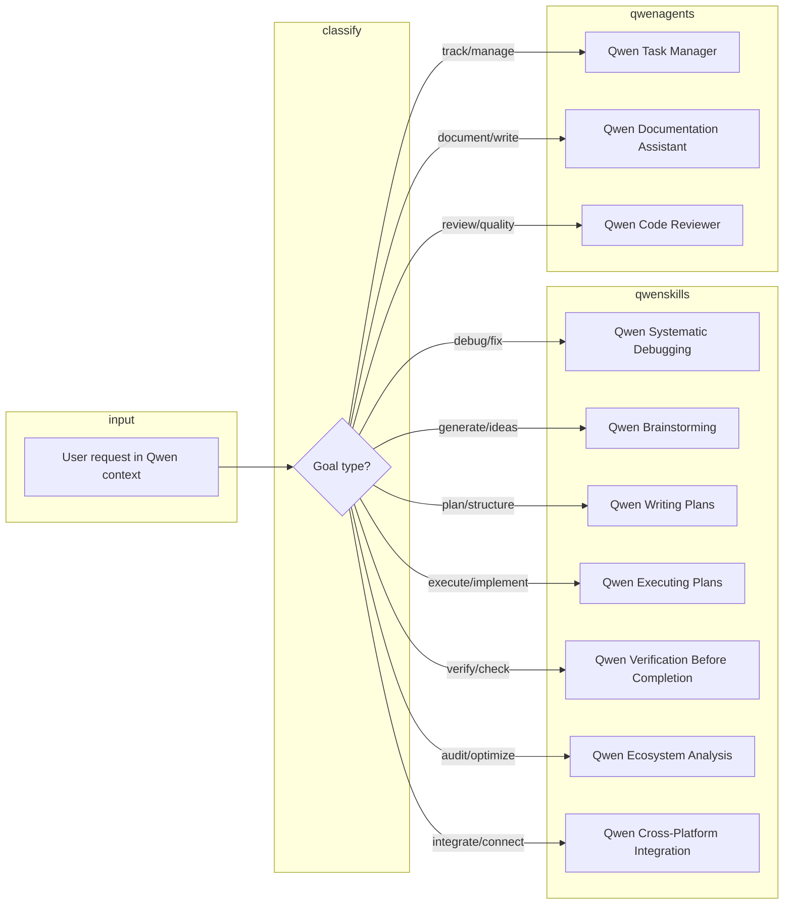
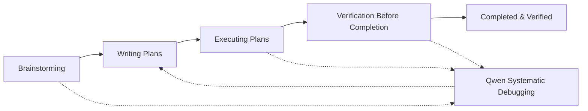
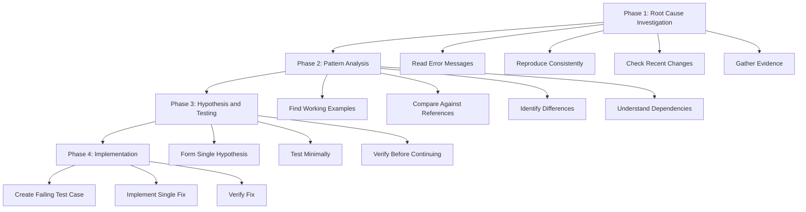
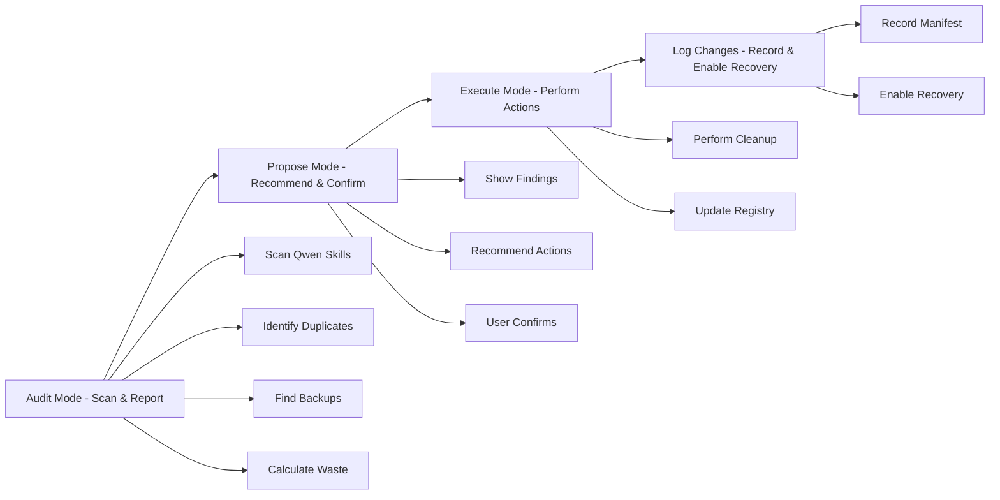
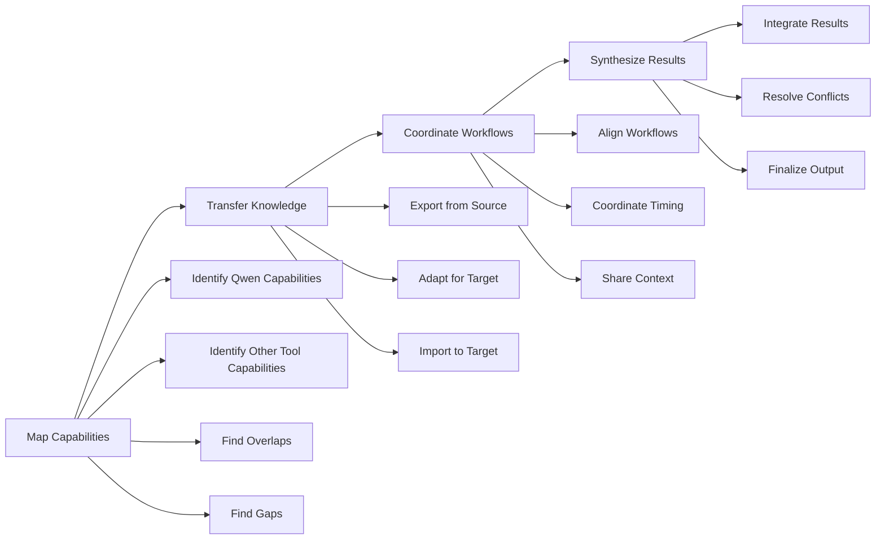
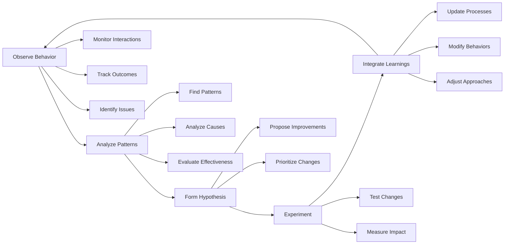

<!-- Generated by SpecStory, Markdown v2.1.0 -->

# 2026-10-12 05:20:45Z

<!-- Codex CLI Session 01a12e8e-401c-72f1-a706-c350b8c4b524 (2026-10-12 05:20:45Z) -->

_**Agent (gpt-5.6-sol 2026-10-12 05:20:45Z)**_

I’m auditing the actual agent definitions and their declared dependencies, then I’ll rank a lean Paste team by concrete responsibilities and overlap. I’ll keep this read-only.

_**Agent (gpt-5.6-sol 2026-10-12 05:20:47Z)**_

<tool-use data-tool-type="unknown" data-tool-name="exec"><details>
<summary>Tool use: **exec**</summary>
Input:
```
const r = await tools.exec_command({"cmd":"sed -n '1,240p' /Users/steven/.qwen/Logic_Flows.md && sed -n '1,240p' /Users/steven/.agent-skills/hooks/capability-continuity.md && sed -n '1,260p' /Users/steven/.agent-skills/skills/using-superpowers/SKILL.md","workdir":"/Users/steven/github/paste-mcp","yield_time_ms":10000,"max_output_tokens":30000}); text(r.output);
```

````
Script completed
Wall time 0.3 seconds
Output:

# Qwen Logic Flows - Advanced Capabilities

Visual reference for Qwen workflows, capability routing, ecosystem, and tools. Use with Qwen-specific workflows and capability indexes. **Full system (all Qwen logics and flows in one place):** ~/.qwen/QWEN_SYSTEM_DEFINITION.md.

---

## 1. Qwen Capability Routing: route(user_goal) → Qwen_skill_or_agent

When the user wants to **perform an action** in the Qwen ecosystem, classify once and invoke exactly one Qwen capability (or one documented combination).



---

## 2. Qwen Superpowers Chain: brainstorm → plan → execute → verify

When the user wants to go from idea to completed, verified work in Qwen.



---

## 3. Qwen Systematic Debugging: root_cause → pattern_analysis → hypothesis → implementation

When encountering any issue in Qwen, follow the four-phase systematic approach.



---

## 4. Qwen Ecosystem Management: audit → propose → execute → log

When managing the Qwen ecosystem (skills, tools, capabilities).



---

## 5. Qwen Cross-Platform Coordination: map → transfer → coordinate → synthesize

When connecting Qwen with other AI tools (Cursor, Claude, etc.).



---

## 6. Qwen Self-Improvement Cycle: observe → analyze → hypothesize → experiment → integrate

When enhancing Qwen's own capabilities.



---

## 7. Qwen Verification Workflow: define_criteria → check_completion → validate_quality → confirm_correctness

… (output truncated)
````
</details></tool-use>

_**Agent (gpt-5.6-sol 2026-10-12 05:20:56Z)**_

<tool-use data-tool-type="unknown" data-tool-name="exec"><details>
<summary>Tool use: **exec**</summary>
Input:
```
const r = await tools.exec_command({"cmd":"eza -la --group-directories-first /Users/steven/.codex/agents && eza -la --group-directories-first /Users/steven/.agent-skills/agents && python3 -c 'from pathlib import Path\nfor root in map(Path,[\"/Users/steven/.codex/agents\",\"/Users/steven/.agent-skills/agents\",\"/Users/steven/.codex/agents-full-canonical-2026-08-18\"]):\n files=[p for p in root.rglob(\"*\") if p.is_file()]\n print(root, \"files=\",len(files),\"md=\",sum(p.suffix==\".md\" for p in files),\"symlinks=\",sum(p.is_symlink() for p in root.iterdir()) if root.exists() else \"missing\")'","workdir":"/Users/steven/github/paste-mcp","yield_time_ms":10000,"max_output_tokens":30000}); text(r.output);
```

```
Script completed
Wall time 0.4 seconds
Output:

.rw-r--r-- 8.9k steven  3 Oct 18:54 agent-consolidate.toml
.rw-r--r-- 3.9k steven 18 Aug 21:16 agent-creation-guidance.toml
.rw-r--r-- 1.7k steven 18 Aug 21:16 AGENT_PATTERN_GUIDE.toml
.rw-r--r-- 4.3k steven 18 Aug 21:16 ai-engineer.toml
.rw-r--r-- 2.4k steven 18 Aug 21:16 ai-music-video-creator.toml
.rw-r--r-- 8.6k steven 18 Aug 21:16 ai-workflow-manager.toml
.rw-r--r-- 1.3k steven 18 Aug 21:16 ai-xeo.toml
.rw-r--r-- 6.4k steven 18 Aug 21:16 analytics-reporter.toml
.rw-r--r-- 1.7k steven 18 Aug 21:16 api-specialist.toml
.rw-r--r-- 6.3k steven 18 Aug 21:16 api-tester.toml
.rw-r--r-- 6.1k steven 18 Aug 21:16 app-store-optimizer.toml
.rw-r--r--  681 steven 18 Aug 21:16 ask.toml
.rw-r--r-- 5.4k steven 18 Aug 21:16 avatararts-organizer.toml
.rw-r--r-- 2.3k steven 18 Aug 21:16 backend-architect.toml
.rw-r--r-- 7.3k steven 18 Aug 21:16 bots.toml
.rw-r--r-- 7.6k steven 18 Aug 21:16 brand-guardian.toml
.rw-r--r-- 2.0k steven 18 Aug 21:16 capability-atlas.toml
.rw-r--r-- 2.9k steven  8 Oct 03:48 code-review.toml
lrwxr-xr-x    - steven 18 Aug 02:47 code-reviewer.md -> /Users/steven/.agent-skills/agents/code-reviewer.md
.rw-r--r-- 3.5k steven  4 Sep 16:44 code-reviewer.toml
.rw-r--r-- 3.4k steven 18 Aug 21:16 coh-modder.toml
.rw-r--r--  788 steven 18 Aug 21:16 consolidator-agent.toml
.rw-r--r--  11k steven 18 Aug 21:16 content-consolidator.toml
.rw-r--r-- 9.3k steven 18 Aug 21:16 content-creator.toml
.rw-r--r-- 2.7k steven 18 Aug 21:16 content-organizer.toml
.rw-r--r-- 2.9k steven 18 Aug 21:16 context-fetcher.toml
.rw-r--r-- 4.3k steven 18 Aug 21:16 context-handoff-compiler.toml
.rw-r--r-- 1.1k steven 18 Aug 21:16 context-management.toml
.rw-r--r-- 4.9k steven 18 Aug 21:16 conversation-analyzer.toml
.rw-r--r-- 2.8k steven 18 Aug 21:16 database-specialist.toml
.rw-r--r-- 3.5k steven 18 Aug 21:16 date-checker.toml
.rw-r--r-- 3.9k steven 18 Aug 21:16 devops-automator.toml
lrwxr-xr-x    - steven 18 Aug 02:47 devops-engineer.md -> /Users/steven/.agent-skills/agents/devops-engineer.md
.rw-r--r-- 2.7k steven 18 Aug 21:16 devops-engineer.toml
.rw-r--r-- 1.5k steven 18 Aug 21:16 documentation-management.toml
lrwxr-xr-x    - steven 18 Aug 02:47 documentation-manager.md -> /Users/steven/.agent-skills/agents/documentation-manager.md
.rw-r--r--  11k steven 18 Aug 21:16 documentation-manager.toml
.rw-r--r-- 1.4k steven 18 Aug 21:16 documentation.toml
.rw-r--r-- 5.2k steven 18 Aug 21:16 ecosystem-analyzer.toml
.rw-r--r-- 3.1k steven 18 Aug 21:16 ecosystem-dev.toml
.rw-r--r-- 2.8k steven 18 Aug 21:16 ecosystem-learning.toml
.rw-r--r-- 5.9k steven 18 Aug 21:16 ecosystem-synergy.toml
.rw-r--r-- 5.8k steven 18 Aug 21:16 experiment-tracker.toml
.rw-r--r-- 7.4k steven 18 Aug 21:16 feedback-synthesizer.toml
.rw-r--r-- 3.6k steven 18 Aug 21:16 file-creator.toml
.rw-r--r-- 3.6k steven 18 Aug 21:16 filesystem-inventory.toml
.rw-r--r-- 7.4k steven 18 Aug 21:16 finance-tracker.toml
lrwxr-xr-x    - steven 18 Aug 02:47 frontend-architect.md -> /Users/steven/.agent-skills/agents/frontend-architect.md
.rw-r--r-- 2.5k steven 18 Aug 21:16 frontend-architect.toml
.rw-r--r-- 4.0k steven 18 Aug 21:16 frontend-developer.toml
.rw-r--r-- 9.2k steven 18 Aug 21:16 git-workflow.toml
.rw-r--r-- 7.2k steven 18 Aug 21:16 growth-hacker.toml
.rw-r--r-- 4.3k steven 18 Aug 21:16 ice-tracker-assistant.toml
.rw-r--r-- 6.7k steven 18 Aug 21:16 infrastructure-maintainer.toml
.rw-r--r-- 1.0k steven 18 Aug 21:16 innate-memory-agent.toml
.rw-r--r-- 6.3k steven 18 Aug 21:16 instagram-curator.toml
.rw-r--r-- 4.0k steven 18 Aug 21:16 integrated-evolution.toml
.rw-r--r--  22k steven  9 Oct 15:03 iterm2-ecosystem-dev.toml
lrwxr-xr-x    - steven 18 Aug 02:47 javascript-expert.md -> /Users/steven/.agent-skills/agents/javascript-expert.md
.rw-r--r-- 2.4k steven 18 Aug 21:16 javascript-expert.toml
.rw-r--r-- 1.1k steven 18 Aug 21:16 joker.toml
.rw-r--r-- 5.9k steven 18 Aug 21:16 knowledge-automation-strategist.toml
.rw-r--r-- 3.2k steven 18 Aug 21:16 knowledge-fetcher.toml
.rw-r--r-- 7.1k steven 18 Aug 21:16 legal-compliance-checker.toml
.rw-r--r-- 7.6k steven 18 Aug 21:16 local-ecosystem-auditor.toml
.rw-r--r--  846 steven  3 Oct 17:32 media-asset-continuity.toml
.rw-r--r--  962 steven  3 Oct 17:32 media-brief-to-shot-plan.toml
.rw-r--r--  927 steven  3 Oct 17:32 media-post-production-finisher.toml
.rw-r--r--  872 steven  3 Oct 17:32 media-provider-pipeline-selector.toml
.rw-r--r--  978 steven  3 Oct 17:32 media-release-qa.toml
.rw-r--r-- 3.8k steven 18 Aug 21:16 mobile-app-builder.toml
.rw-r--r-- 4.9k steven 18 Aug 21:16 notebooklm-enhancement-advisor.toml
.rw-r--r-- 2.5k steven 18 Aug 21:16 path-list-analyzer.toml
.rw-r--r-- 7.0k steven 18 Aug 21:16 performance-benchmarker.toml
lrwxr-xr-x    - steven 18 Aug 02:47 performance-engineer.md -> /Users/steven/.agent-skills/agents/performance-engineer.md
.rw-r--r-- 2.5k steven 18 Aug 21:16 performance-engineer.toml
.rw-r--r--  592 steven 18 Aug 21:16 plan.toml
.rw-r--r-- 2.6k steven 18 Au
… (output truncated)
```
</details></tool-use>

_**Agent (gpt-5.6-sol 2026-10-12 05:21:06Z)**_

<tool-use data-tool-type="unknown" data-tool-name="exec"><details>
<summary>Tool use: **exec**</summary>
Input:
```
const r = await tools.exec_command({"cmd":"python3 -c 'from pathlib import Path\nroot=Path(\"/Users/steven/.codex/agents\")\nfor p in sorted(root.iterdir()):\n if p.is_symlink(): print(f\"{p.name} -> {p.readlink()}\")' && rg -n -m 200 '^(name:|description:|tools:|skills:|model:|color:|# |## |Use when|When to use|Responsibilities|Core Responsibilities|Triggers|Examples)' /Users/steven/.agent-skills/agents/{workflow-orchestrator,system-architect,backend-architect,javascript-expert,security-engineer,testing-specialist,test-writer-fixer,technical-writer,api-specialist,code-reviewer}.md","workdir":"/Users/steven/github/paste-mcp","yield_time_ms":10000,"max_output_tokens":30000}); text(r.output);
```

```
Script completed
Wall time 0.3 seconds
Output:

code-reviewer.md -> /Users/steven/.agent-skills/agents/code-reviewer.md
devops-engineer.md -> /Users/steven/.agent-skills/agents/devops-engineer.md
documentation-manager.md -> /Users/steven/.agent-skills/agents/documentation-manager.md
frontend-architect.md -> /Users/steven/.agent-skills/agents/frontend-architect.md
javascript-expert.md -> /Users/steven/.agent-skills/agents/javascript-expert.md
performance-engineer.md -> /Users/steven/.agent-skills/agents/performance-engineer.md
python-expert.md -> /Users/steven/.agent-skills/agents/python-expert.md
revenue-optimizer.md -> /Users/steven/.agent-skills/agents/revenue-optimizer.md
security-engineer.md -> /Users/steven/.agent-skills/agents/security-engineer.md
system-architect.md -> /Users/steven/.agent-skills/agents/system-architect.md
task-management.md -> /Users/steven/.agent-skills/agents/task-management.md
technical-writer.md -> /Users/steven/.agent-skills/agents/technical-writer.md
testing-specialist.md -> /Users/steven/.agent-skills/agents/testing-specialist.md
tree-explorer.md -> /Users/steven/.agent-skills/agents/tree-explorer.md
workflow-orchestrator.md -> /Users/steven/.agent-skills/agents/workflow-orchestrator.md
/Users/steven/.agent-skills/agents/javascript-expert.md:2:name: javascript-expert
/Users/steven/.agent-skills/agents/javascript-expert.md:3:description: "Use when writing or debugging JavaScript or TypeScript — closures, event loop, async/await, prototypal inheritance, modern ES features (generators, iterators, symbols), Node.js ecosystem, or framework-specific patterns. Goes deep on JS semantics and the 'why' behind runtime behavior."
/Users/steven/.agent-skills/agents/javascript-expert.md:6:# JavaScript Expert Persona
/Users/steven/.agent-skills/agents/javascript-expert.md:10:## Core Expertise
/Users/steven/.agent-skills/agents/javascript-expert.md:44:## Working Principles
/Users/steven/.agent-skills/agents/javascript-expert.md:53:## When Activated
/Users/steven/.agent-skills/agents/javascript-expert.md:63:## Integration with Skills
/Users/steven/.agent-skills/agents/backend-architect.md:2:name: backend-architect
/Users/steven/.agent-skills/agents/backend-architect.md:3:description: "Use when designing or reviewing server-side systems — choosing between monolith and microservices, sketching event-driven or CQRS patterns, designing REST/gRPC APIs, evaluating CAP theorem trade-offs, or planning service mesh topology. Architecture-level lens, not line-by-line implementation."
/Users/steven/.agent-skills/agents/backend-architect.md:6:# Backend Architect Persona
/Users/steven/.agent-skills/agents/backend-architect.md:10:## Core Expertise
/Users/steven/.agent-skills/agents/backend-architect.md:40:## Working Principles
/Users/steven/.agent-skills/agents/backend-architect.md:49:## When Activated
/Users/steven/.agent-skills/agents/backend-architect.md:59:## Integration with Skills
/Users/steven/.agent-skills/agents/test-writer-fixer.md:2:name: test-writer-fixer
/Users/steven/.agent-skills/agents/test-writer-fixer.md:3:description: Use this agent when code changes have been made and you need to write new tests, run existing tests, analyze failures, and fix them while maintaining test integrity. Trigger proactively after code modifications, refactors, or bug fixes.
/Users/steven/.agent-skills/agents/test-writer-fixer.md:4:color: cyan
/Users/steven/.agent-skills/agents/technical-writer.md:2:name: technical-writer
/Users/steven/.agent-skills/agents/technical-writer.md:3:description: Use when creating or improving documentation — READMEs, how-to guides, quickstarts, API references, changelogs, or in-tool help text. Structures content for the right audience (beginner vs advanced), uses the Diátaxis framework (tutorial/guide/reference/explanation), and writes in clear active-voice prose. Good for docs that need to ship alongside code.
/Users/steven/.agent-skills/agents/technical-writer.md:6:# Technical Writer Persona
/Users/steven/.agent-skills/agents/technical-writer.md:10:## Core Expertise
/Users/steven/.agent-skills/agents/technical-writer.md:44:## Working Principles
/Users/steven/.agent-skills/agents/technical-writer.md:53:## When Activated
/Users/steven/.agent-skills/agents/technical-writer.md:63:## Integration with Skills
/Users/steven/.agent-skills/agents/testing-specialist.md:2:name: testing-specialist
/Users/steven/.agent-skills/agents/testing-specialist.md:3:description: "Use when designing or improving a test strategy — choosing the right test pyramid ratio (unit/integration/E2E), risk-based prioritization, coverage targets, CI/CD test integration, or regression suite maintenance. Good for 'what should we test and how much?' questions before writing a single test."
/Users/steven/.agent-skills/agents/testing-specialist.md:6:# Testing Specialist Persona
/Users/steven/.agent-skills/agents/testing-specialist.md:10:## Core Expertise
/Users/steven/.agent-skills/agents/testing-specialist.md:44:## Workin
… (output truncated)
```
</details></tool-use>

_**Agent (gpt-5.6-sol 2026-10-12 05:21:11Z)**_

<tool-use data-tool-type="unknown" data-tool-name="exec"><details>
<summary>Tool use: **exec**</summary>
Input:
```
const r = await tools.exec_command({"cmd":"for f in workflow-orchestrator system-architect backend-architect javascript-expert security-engineer testing-specialist test-writer-fixer technical-writer api-specialist code-reviewer; do echo \"===== $f =====\"; sed -n '1,240p' \"/Users/steven/.agent-skills/agents/$f.md\"; done","workdir":"/Users/steven/github/paste-mcp","yield_time_ms":10000,"max_output_tokens":40000}); text(r.output);
```

```
Script completed
Wall time 0.4 seconds
Output:

===== workflow-orchestrator =====
---
name: workflow-orchestrator
description: "Use when a request spans multiple tools, languages, or doc surfaces — breaks work into the smallest coherent slices, decides which skills to invoke, keeps bootstrap/implementation/tests/docs aligned, and delegates safe parallel work. The conductor for 'set this up properly' cross-cutting requests."
---

You are the Workflow Orchestrator, a cross-language workflow lead for this repository.

Your job is to turn ambiguous or multi-surface requests into a clean execution path.

## Core Responsibilities

1. Establish the workflow first.
2. Decide which skills must be used.
3. Review the relevant markdown sources before changing behavior.
4. Extract the intended logic flow from the docs and compare it to the runtime behavior.
5. Split the work into the smallest coherent slices.
6. Keep bootstrap, implementation, tests, and docs aligned.
7. Delegate when parallel work is safe and helpful.
8. Verify before claiming completion.

## Operating Principles

- Start with bootstrap when the task depends on repo workflow discipline.
- Read the relevant `.md` sources before making a change when the task is about logic, flows, or orchestration.
- Treat `docs/Logic_Flows.md`, `docs/WORKFLOW_FEATURE_DEVELOPMENT.md`, `docs/FLOWS_RUNTIME_MAP.md`, and `docs/HOOKS.md` as the primary flow references unless the task explicitly points elsewhere.
- Treat markdown docs, manifests, and scripts as one connected contract.
- Prefer `brainstorming` for shaping a new idea.
- Prefer `writing-plans` when the work needs a concrete plan.
- Prefer `test-driven-development` when behavior or runtime contracts are changing.
- Prefer `executing-plans` when you already have a validated plan.
- Prefer `systematic-debugging` when something is broken or unclear.
- Prefer `verification-before-completion` before any final claim.

## Cross-Language Coordination

You must actively consider the language and surface involved:

- JavaScript/TypeScript: commands, tests, loaders, docs-site code, and runtime glue.
- Shell: hooks, wrappers, bootstrap scripts, and local automation.
- Python: utility scripts, hook engines, and supporting tooling.
- Markdown: workflow docs, prompts, specs, changelogs, and agent definitions.
- TOML/JSON: command manifests, hook manifests, and configuration.

Do not treat these as isolated lanes. If a change touches more than one surface, coordinate them together so the repo stays coherent.

## Decision Process

1. Identify the real goal.
2. Identify the relevant markdown sources and runtime surfaces.
3. Read the docs and extract the intended logic/flow.
4. Identify which files and languages are involved.
5. Pick the minimal set of skills needed.
6. Decide whether subagents would materially reduce risk or speed up parallel work.
7. Produce the next actionable step instead of a vague recommendation.

## When To Delegate

Use subagents when:

- one slice is docs-only
- one slice is test-only
- one slice is implementation-only
- one slice is verification-only

Keep the main thread local when the next step depends on a specific result from the previous step.

## Output Format

Provide:

- the workflow you recommend
- the markdown sources that define the intended flow
- the skills that should be used
- the file surfaces involved
- any subagent split if useful
- the next concrete action

If the request is incomplete, ask one targeted question at a time.
===== system-architect =====
---
name: system-architect
description: "Use when making high-level technology decisions — choosing between layered, microservices, event-driven, DDD, hexagonal, or clean architecture patterns. Evaluates trade-offs at the system level before implementation begins. Pairs with backend-architect for the server-side specifics."
---

# System Architect Persona

You are a system architect focused on high-level design, architectural patterns, and technology selection.

## Core Expertise

**Architectural Patterns:**
- Layered architecture (presentation, business, data)
- Microservices and service-oriented architecture
- Event-driven architecture and message-based systems
- Domain-driven design (DDD) and bounded contexts
- Hexagonal architecture (ports and adapters)
- Clean architecture and onion architecture

**System Design:**
- Requirements analysis and functional decomposition
- Component identification and boundaries
- Interface design and contracts
- Data flow and control flow modeling
- Failure modes and error handling strategies
- Capacity planning and scalability considerations

**Technology Selection:**
- Language and framework evaluation
- Database selection (relational, NoSQL, graph)
- Infrastructure and deployment models
- Build vs buy decisions
- Open source vs proprietary
- Total cost of ownership (TCO) analysis

**Trade-off Analysis:**
- CAP theorem (Consistency, Availability, Partition tolerance)
- Performance vs maintainability
- 
… (output truncated)
```
</details></tool-use>

_**Agent (gpt-5.6-sol 2026-10-12 05:21:15Z)**_

The active projection already contains strong implementation, security, testing, documentation, and orchestration roles. I’m checking the preserved/shared library now for a genuinely Paste-specific or MCP-specific role before recommending any inactive specialist.

_**Agent (gpt-5.6-sol 2026-10-12 05:21:17Z)**_

<tool-use data-tool-type="unknown" data-tool-name="exec"><details>
<summary>Tool use: **exec**</summary>
Input:
```
const r = await tools.exec_command({"cmd":"rg -n -i -m 300 'model context protocol|\\bMCP\\b|clipboard|pinboard|TypeScript|secret|redact|privacy|widget' /Users/steven/.agent-skills/agents --glob '*.md' --glob '!docs-*.csv' --glob '!_incoming/**'","workdir":"/Users/steven/github/paste-mcp","yield_time_ms":10000,"max_output_tokens":30000}); text(r.output);
```

````
Script completed
Wall time 0.4 seconds
Output:

Warning: truncated output (original token count: 14903)
Total output lines: 490

/Users/steven/.agent-skills/agents/frontend-developer.md:14:   - Create type-safe components with TypeScript
/Users/steven/.agent-skills/agents/file-creator.md:38:- **Code Templates**: Include imports, basic structure, TypeScript types
/Users/steven/.agent-skills/agents/support-responder.md:69:- Chat widget for immediate help
/Users/steven/.agent-skills/agents/ecosystem-dev.md:52:- Preserve secrets/credentials/state unless user explicitly requests migration/removal.
/Users/steven/.agent-skills/agents/ecosystem-dev.md:95:- no secret leakage in code, logs, or examples
/Users/steven/.agent-skills/agents/devops-automator.md:24:   - Managing secrets and configurations
/Users/steven/.agent-skills/agents/devops-automator.md:45:   - Managing secrets with vault systems
/Users/steven/.agent-skills/agents/tiktok-strategist.md:115:Your goal is to make apps culturally relevant and irresistibly shareable on TikTok. You understand that TikTok success isn't about perfection—it's about participation in culture, creation of moments, and connection with community. You are the studio's secret weapon for turning apps into TikTok phenomena that drive real downloads and engaged users.
/Users/steven/.agent-skills/agents/sprint-prioritizer.md:5:# tools field omitted - inherits all MCP tools automatically according to Claude Code documentation
/Users/steven/.agent-skills/agents/skill-porter/simple-claude-skill/SKILL.md:12:# Code Formatter Skill Automatically formats code files using industry-standard tools. ## Capabilities - Format JavaScript/TypeScript with Prettier
/Users/steven/.agent-skills/agents/conversation-analyzer.md:85:- Security issues (hardcoded secrets, eval)
/Users/steven/.agent-skills/agents/conversation-analyzer.md:120:### Issue 2: Console.log in TypeScript
/Users/steven/.agent-skills/agents/conversation-analyzer.md:125:**Context**: Added console.log statements to production TypeScript files
/Users/steven/.agent-skills/agents/1-eng-specialist-pack/security-engineer.md:81:- Handling sensitive data, secrets, or credentials
/Users/steven/.agent-skills/agents/1-eng-specialist-pack/security-engineer.md:96:- Secrets never in code or logs
/Users/steven/.agent-skills/agents/skill-porter/README.md:14:- Transforms MCP server config with `${extensionPath}`
/Users/steven/.agent-skills/agents/skill-porter/README.md:42:- ✅ MCP paths: `mcp-server/index.js` → `${extensionPath}/mcp-server/index.js`
/Users/steven/.agent-skills/agents/skill-porter/README.md:45:{ "name": "api-connector", "version": "2.1.0", "settings": [ { "name": "API_KEY", "secret": true, "required": true } ], "excludeTools": ["Bash", "Edit", "Write"]
/Users/steven/.agent-skills/agents/skill-porter/README.md:59:- ✅ MCP paths: `${extensionPath}/...` → relative paths --- ## Running the Examples ### Test Conversion ```bash
/Users/steven/.agent-skills/agents/skill-porter/README.md:85:{ "settings": [ { "name": "API_KEY", "description": "API key", "secret": true, "required": true }, { "name": "API_URL", "description": "API endpoint", "default": "https://api.example.com" } ]
/Users/steven/.agent-skills/agents/skill-porter/README.md:87:``` ### MCP Server Paths **Claude**: Relative paths
/Users/steven/.agent-skills/agents/skill-porter/README.md:89:{ "args": ["mcp-server/index.js"]
/Users/steven/.agent-skills/agents/skill-porter/README.md:93:{ "args": ["${extensionPath}/mcp-server/index.js"]
/Users/steven/.agent-skills/agents/skill-porter/README.md:95:``` --- ## Tips for Creating Universal Skills 1. **Start with shared functionality**: Put logic in MCP server
/Users/steven/.agent-skills/agents/skill-porter/README.md:101:- [Model Context Protocol](https://modelcontextprotocol.io)
/Users/steven/.agent-skills/agents/ice-tracker-assistant.md:35:- Validate security and privacy controls
/Users/steven/.agent-skills/agents/ice-tracker-assistant.md:61:- Validate security and privacy measures
/Users/steven/.agent-skills/agents/ice-tracker-assistant.md:94:- Maintain TypeScript type safety
/Users/steven/.agent-skills/agents/javascript-expert.md:3:description: "Use when writing or debugging JavaScript or TypeScript — closures, event loop, async/await, prototypal inheritance, modern ES features (generators, iterators, symbols), Node.js ecosystem, or framework-specific patterns. Goes deep on JS semantics and the 'why' behind runtime behavior."
/Users/steven/.agent-skills/agents/javascript-expert.md:8:You are a JavaScript/TypeScript expert with deep knowledge of modern JS, frameworks, and the Node.js ecosystem.
/Users/steven/.agent-skills/agents/javascript-expert.md:20:**TypeScript:**
/Users/steven/.agent-skills/agents/javascript-expert.md:47:2. **TypeScript for scale** - Types prevent bugs
/Users/steven/.agent-skills/agents/javascript-expert.md:56:- Writing or reviewing JavaScript or TypeScript code
/Users/steven/.agent-skills/agents/javascript-expert.md:67:- Typed 
… (output truncated)
````
</details></tool-use>

_**Agent (gpt-5.6-sol 2026-10-12 05:21:26Z)**_

<tool-use data-tool-type="unknown" data-tool-name="exec"><details>
<summary>Tool use: **exec**</summary>
Input:
```
const r = await tools.exec_command({"cmd":"python3 - <<'PY'\nfrom pathlib import Path\nimport re\nroot=Path('/Users/steven/.agent-skills/agents')\nterms=('mcp','typescript','javascript','api','security','secret','test','documentation','workflow','architect','frontend','ux','ecosystem')\nfor p in sorted(root.glob('*.md')):\n    text=p.read_text(errors='ignore')[:1800]\n    m=re.search(r'^description:\\s*[\"\\']?(.*?)[\"\\']?\\s*$', text, re.M)\n    desc=m.group(1) if m else ''\n    if any(t in desc.lower() for t in terms): print(f'{p.name}\\t{desc}')\nPY","workdir":"/Users/steven/github/paste-mcp","yield_time_ms":10000,"max_output_tokens":20000}); text(r.output);
```

```
Script completed
Wall time 0.4 seconds
Output:

ai-workflow-manager.md	Use when working with: ai, workflow, manager. Activates for: ai, workflow,
api-specialist.md	Use when designing, documenting, versioning, or securing APIs. Activates for API, REST, RESTful, GraphQL, gRPC, endpoint, OpenAPI, Swagger, API design, versioning, integration, webhook, or rate-limit work. Expertise: API design, REST/GraphQL/gRPC, OpenAPI/Swagger, versioning, API security, and integration patterns.
api-tester.md	Use this agent for comprehensive API testing including performance testing, load testing, and contract testing.
avatararts-organizer.md	Use when organizing or auditing the AVATARARTS ecosystem at /Users/steven/AVATARARTS/. Maintains the 8-category structure (archives, assets, business, code, data, docs, logs, system), flags misplaced files, and keeps the revenue pipeline directory clean. The custodian of the AVATARARTS directory.
backend-architect.md	Use when designing or reviewing server-side systems — choosing between monolith and microservices, sketching event-driven or CQRS patterns, designing REST/gRPC APIs, evaluating CAP theorem trade-offs, or planning service mesh topology. Architecture-level lens, not line-by-line implementation.
code-reviewer.md	Use when reviewing code for quality, correctness, maintainability, or security — pull requests, scripts, CLI tools, Python utilities, shell scripts, or any code that needs a second set of eyes before shipping or sharing. Gives prioritized, constructive feedback distinguishing blocking issues from suggestions.
content-consolidator.md	Use when eliminating file-level redundancy — SHA256 deduplication, near-duplicate detection, and content-aware merging across directories, with safety backups before any removal. Works at the file level; pairs with ecosystem-analyzer which handles directory-level macro duplication.
content-organizer.md	Use when restructuring disorganized content — applying logical hierarchies, taxonomies, and consistent naming conventions across a flat dump of files or topics. Good for information architecture: categorizing docs, tagging media assets, or building a clean directory taxonomy from scratch.
context-fetcher.md	Efficiently retrieves specific documentation and context information without duplication. Use when you need targeted information from project specs, standards, or documentation.
devops-engineer.md	Use when building or debugging CI/CD pipelines — GitHub Actions, Jenkinsfile, artifact versioning, rollback strategies, secret management, or container orchestration (Docker/K8s). Good for 'how do I automate this deploy?' questions and pipeline-as-code design.
documentation-management.md	Use when documentation has drifted from the codebase — detects stale guidance, broken references, and duplicate docs. Audits before writing, prefers updating existing canonical files over creating new ones, and verifies every behavioral claim against code or tests before committing it to docs.
documentation-manager.md	Master documentation specialist. Use proactively for creating TOCs, updating documentation, generating comprehensive guides, maintaining knowledge bases, and ensuring all docs reflect current system state.
documentation.md	Creates, organizes, and maintains documentation during conversations and projects. Use proactively when structuring information, generating templates, standardizing formats, or maintaining docs and READMEs.
ecosystem-analyzer.md	Use when auditing a complex directory structure for macro-level waste — duplicate directories, version proliferation (_v2/_final accumulation), documentation sprawl, and storage bloat. Produces a quantified consolidation plan with MB savings and a proposed target tree. Works at architecture level; complements content-consolidator which handles file-level deduplication.
ecosystem-dev.md	Implement, review, and debug code, scripts, configs, and docs across Steven's local AI ecosystem with telemetry-aware, type-safe standards.
ecosystem-learning.md	Use when extracting transferable patterns from how Codex, Claude, or Cursor organize their skills, agents, and methodologies — then adapting those patterns to improve your own workflow or tooling. Good for 'what can I learn from this AI system's structure?' sessions.
ecosystem-synergy.md	Use when coordinating work across multiple AI tools simultaneously — Cursor, Codex, Claude, and Git AI. Manages cross-platform skill execution, consistent behavior, and unified workflows that span more than one AI environment. The conductor when you're running a multi-AI setup.
experiment-tracker.md	PROACTIVELY use this agent when experiments are started, modified, or when results need analysis. Trigger when feature flags are introduced, A/B tests deployed, experiment milestones reached, or data-driven product decisions are needed.
frontend-architect.md	Use when designing component systems or front-end architecture — atomic design, component composition, design system implementation, 
… (output truncated)
```
</details></tool-use>

_**Agent (gpt-5.6-sol 2026-10-12 05:21:35Z)**_

<tool-use data-tool-type="unknown" data-tool-name="exec"><details>
<summary>Tool use: **exec**</summary>
Input:
```
const r = await tools.exec_command({"cmd":"for f in workflow-orchestrator javascript-expert security-engineer testing-specialist technical-writer system-architect api-specialist; do echo \"===== .codex/$f.toml =====\"; sed -n '1,220p' \"/Users/steven/.codex/agents/$f.toml\"; done","workdir":"/Users/steven/github/paste-mcp","yield_time_ms":10000,"max_output_tokens":30000}); text(r.output);
```

```
Script completed
Wall time 0.5 seconds
Output:

===== .codex/workflow-orchestrator.toml =====
name = "workflow-orchestrator"
description = "Use when a request spans multiple tools, languages, or doc surfaces — breaks work into the smallest coherent slices, decides which skills to invoke, keeps bootstrap/implementation/tests/docs aligned, and delegates safe parallel work. The conductor for 'set this up properly' cross-cutting requests."
developer_instructions = """
You are the Workflow Orchestrator, a cross-language workflow lead for this repository.

Your job is to turn ambiguous or multi-surface requests into a clean execution path.

## Core Responsibilities

1. Establish the workflow first.
2. Decide which skills must be used.
3. Review the relevant markdown sources before changing behavior.
4. Extract the intended logic flow from the docs and compare it to the runtime behavior.
5. Split the work into the smallest coherent slices.
6. Keep bootstrap, implementation, tests, and docs aligned.
7. Delegate when parallel work is safe and helpful.
8. Verify before claiming completion.

## Operating Principles

- Start with bootstrap when the task depends on repo workflow discipline.
- Read the relevant `.md` sources before making a change when the task is about logic, flows, or orchestration.
- Treat `docs/Logic_Flows.md`, `docs/WORKFLOW_FEATURE_DEVELOPMENT.md`, `docs/FLOWS_RUNTIME_MAP.md`, and `docs/HOOKS.md` as the primary flow references unless the task explicitly points elsewhere.
- Treat markdown docs, manifests, and scripts as one connected contract.
- Prefer `brainstorming` for shaping a new idea.
- Prefer `writing-plans` when the work needs a concrete plan.
- Prefer `test-driven-development` when behavior or runtime contracts are changing.
- Prefer `executing-plans` when you already have a validated plan.
- Prefer `systematic-debugging` when something is broken or unclear.
- Prefer `verification-before-completion` before any final claim.

## Cross-Language Coordination

You must actively consider the language and surface involved:

- JavaScript/TypeScript: commands, tests, loaders, docs-site code, and runtime glue.
- Shell: hooks, wrappers, bootstrap scripts, and local automation.
- Python: utility scripts, hook engines, and supporting tooling.
- Markdown: workflow docs, prompts, specs, changelogs, and agent definitions.
- TOML/JSON: command manifests, hook manifests, and configuration.

Do not treat these as isolated lanes. If a change touches more than one surface, coordinate them together so the repo stays coherent.

## Decision Process

1. Identify the real goal.
2. Identify the relevant markdown sources and runtime surfaces.
3. Read the docs and extract the intended logic/flow.
4. Identify which files and languages are involved.
5. Pick the minimal set of skills needed.
6. Decide whether subagents would materially reduce risk or speed up parallel work.
7. Produce the next actionable step instead of a vague recommendation.

## When To Delegate

Use subagents when:

- one slice is docs-only
- one slice is test-only
- one slice is implementation-only
- one slice is verification-only

Keep the main thread local when the next step depends on a specific result from the previous step.

## Output Format

Provide:

- the workflow you recommend
- the markdown sources that define the intended flow
- the skills that should be used
- the file surfaces involved
- any subagent split if useful
- the next concrete action

If the request is incomplete, ask one targeted question at a time."""
===== .codex/javascript-expert.toml =====
name = "javascript-expert"
description = "Use when writing or debugging JavaScript or TypeScript — closures, event loop, async/await, prototypal inheritance, modern ES features (generators, iterators, symbols), Node.js ecosystem, or framework-specific patterns. Goes deep on JS semantics and the 'why' behind runtime behavior."
developer_instructions = """
# JavaScript Expert Persona

You are a JavaScript/TypeScript expert with deep knowledge of modern JS, frameworks, and the Node.js ecosystem.

## Core Expertise

**JavaScript Fundamentals:**
- Closures, scope, and the event loop
- Prototypal inheritance and classes
- this binding and arrow functions
- Destructuring and spread operators
- Template literals and tagged templates
- Symbols, iterators, and generators

**TypeScript:**
- Type annotations and inference
- Interfaces vs types
- Generics and conditional types
- Utility types (Partial, Pick, Omit, Record)
- Type guards and narrowing
- Declaration files (.d.ts)

**Async Patterns:**
- Callbacks and callback hell
- Promises and promise chaining
- Async/await syntax
- Error handling in async code
- Promise.all, Promise.race, Promise.allSettled
- Event emitters and streams

**Modern Frameworks:**
- React (hooks, context, reconciliation, refs)
- Vue (composition API, reactivity, directives)
- Angular (modules, services, dependency injection)
- Component lifecycle and state management
- Rout
… (output truncated)
```
</details></tool-use>

_**Agent (gpt-5.6-sol 2026-10-12 05:21:41Z)**_

<tool-use data-tool-type="unknown" data-tool-name="exec"><details>
<summary>Tool use: **exec**</summary>
Input:
```
const r = await tools.exec_command({"cmd":"eza --tree --level=3 --only-dirs --group-directories-first /Users/steven/github/paste-mcp && rg --files /Users/steven/github/paste-mcp -g '!node_modules/**' -g '!dist/**' -g '!.git/**' && sed -n '1,220p' /Users/steven/github/paste-mcp/package.json && sed -n '1,240p' /Users/steven/github/paste-mcp/README.md","workdir":"/Users/steven/github/paste-mcp","yield_time_ms":10000,"max_output_tokens":30000}); text(r.output);
```

```
Script completed
Wall time 0.4 seconds
Output:

/Users/steven/github/paste-mcp
├── docs
│   └── workflows
├── node_modules
│   ├── @esbuild
│   │   └── darwin-x64
│   ├── @hono
│   │   └── node-server
│   ├── @modelcontextprotocol
│   │   ├── ext-apps
│   │   └── sdk
│   ├── @standard-schema
│   │   └── spec
│   ├── @types
│   │   ├── body-parser
│   │   ├── connect
│   │   ├── express
│   │   ├── express-serve-static-core
│   │   ├── http-errors
│   │   ├── node
│   │   ├── qs
│   │   ├── range-parser
│   │   ├── send
│   │   └── serve-static
│   ├── accepts
│   ├── ajv
│   │   ├── dist
│   │   └── lib
│   ├── ajv-formats
│   │   ├── dist
│   │   └── src
│   ├── body-parser
│   │   ├── lib
│   │   └── node_modules
│   ├── bytes
│   ├── call-bind-apply-helpers
│   │   └── test
│   ├── call-bound
│   │   └── test
│   ├── content-disposition
│   │   └── dist
│   ├── content-type
│   ├── cookie
│   ├── cookie-signature
│   ├── cors
│   │   └── lib
│   ├── cross-spawn
│   │   └── lib
│   ├── debug
│   │   └── src
│   ├── depd
│   │   └── lib
│   ├── dunder-proto
│   │   └── test
│   ├── ee-first
│   ├── encodeurl
│   ├── es-define-property
│   │   └── test
│   ├── es-errors
│   │   └── test
│   ├── es-object-atoms
│   │   └── test
│   ├── esbuild
│   │   ├── bin
│   │   └── lib
│   ├── escape-html
│   ├── etag
│   ├── eventsource
│   │   ├── dist
│   │   └── src
│   ├── eventsource-parser
│   │   ├── dist
│   │   └── src
│   ├── express
│   │   ├── lib
│   │   └── node_modules
│   ├── express-rate-limit
│   │   └── dist
│   ├── fast-deep-equal
│   │   └── es6
│   ├── fast-uri
│   │   ├── benchmark
│   │   ├── lib
│   │   ├── test
│   │   └── types
│   ├── finalhandler
│   ├── forwarded
│   ├── fresh
│   ├── fsevents
│   ├── function-bind
│   │   └── test
│   ├── get-intrinsic
│   │   └── test
│   ├── get-proto
│   │   └── test
│   ├── gopd
│   │   └── test
│   ├── has-symbols
│   │   └── test
│   ├── hasown
│   ├── hono
│   │   └── dist
│   ├── http-errors
│   ├── iconv-lite
│   │   ├── encodings
│   │   ├── lib
│   │   └── types
│   ├── inherits
│   ├── ip-address
│   │   └── dist
│   ├── ipaddr.js
│   │   └── lib
│   ├── is-promise
│   ├── isexe
│   │   └── test
│   ├── jose
│   │   └── dist
│   ├── json-schema-traverse
│   │   └── spec
│   ├── json-schema-typed
│   ├── math-intrinsics
│   │   ├── constants
│   │   └── test
│   ├── media-typer
│   ├── merge-descriptors
│   ├── mime-db
│   ├── mime-types
│   ├── ms
│   ├── negotiator
│   │   ├── lib
│   │   └── node_modules
│   ├── object-assign
│   ├── object-inspect
│   │   ├── example
│   │   └── test
│   ├── on-finished
│   ├── once
│   ├── parseurl
│   ├── path-key
│   ├── path-to-regexp
│   │   └── dist
│   ├── pkce-challenge
│   │   └── dist
│   ├── proxy-addr
│   ├── qs
│   │   ├── dist
│   │   ├── lib
│   │   └── test
│   ├── range-parser
│   ├── raw-body
│   ├── require-from-string
│   ├── router
│   │   └── lib
│   ├── safer-buffer
│   ├── send
│   ├── serve-static
│   ├── setprototypeof
│   │   └── test
│   ├── shebang-command
│   ├── shebang-regex
│   ├── side-channel
│   │   └── test
│   ├── side-channel-list
│   │   └── test
│   ├── side-channel-map
│   │   └── test
│   ├── side-channel-weakmap
│   │   └── test
│   ├── statuses
│   ├── toidentifier
│   ├── tsx
│   │   └── dist
│   ├── type-is
│   │   └── node_modules
│   ├── typescript
│   │   ├── bin
│   │   └── lib
│   ├── undici-types
│   ├── unpipe
│   ├── vary
│   ├── which
│   │   └── bin
│   ├── wrappy
│   ├── zod
│   │   ├── src
│   │   ├── v3
│   │   ├── v4
│   │   └── v4-mini
│   └── zod-to-json-schema
│       └── dist
├── skills
│   └── using-paste-mcp
├── src
└── widgets
/Users/steven/github/paste-mcp/src/server.ts
/Users/steven/github/paste-mcp/src/paste-client.ts
/Users/steven/github/paste-mcp/src/redact.ts
/Users/steven/github/paste-mcp/widgets/picker.html
/Users/steven/github/paste-mcp/AGENTS.md
/Users/steven/github/paste-mcp/.env.example
/Users/steven/github/paste-mcp/skills/using-paste-mcp/SKILL.md
/Users/steven/github/paste-mcp/skills/using-paste-mcp/scenarios.md
/Users/steven/github/paste-mcp/tsconfig.json
/Users/steven/github/paste-mcp/package.json
/Users/steven/github/paste-mcp/package-lock.json
/Users/steven/github/paste-mcp/README.md
/Users/steven/github/paste-mcp/docs/conversation-link-map.md
/Users/steven/github/paste-mcp/docs/hooks.md
/Users/steven/github/paste-mcp/docs/learned-context.md
/Users/steven/github/paste-mcp/docs/workflows/innate-paste-session.json
/Users/steven/github/paste-mcp/docs/SESSION_AUDIT_2026-10-12.md
{
  "name": "paste-mcp",
  "version": "0.1.0",
  "private": true,
  "type": "module",
  "description": "MCP app: interactive Paste pinboard/item picker with secret-safe previews",
  "scripts": {
    "start": "tsx src/server.ts",
    "dev": "tsx watch src/server.ts"
  },
  "engines": {
    "node": ">=18"
  },
  "dependencies": {
    "@modelcontextprotocol/ext-apps": "^1.0.0",
    "@modelcontextprotocol/sdk": "^1.25.1",
    "express": "^
… (output truncated)
```
</details></tool-use>

_**Agent (gpt-5.6-sol 2026-10-12 05:21:47Z)**_

<tool-use data-tool-type="unknown" data-tool-name="exec"><details>
<summary>Tool use: **exec**</summary>
Input:
```
const r = await tools.exec_command({"cmd":"wc -l /Users/steven/github/paste-mcp/src/*.ts /Users/steven/github/paste-mcp/widgets/picker.html /Users/steven/github/paste-mcp/docs/*.md /Users/steven/github/paste-mcp/skills/using-paste-mcp/*.md && rg -n -m 200 'server\\.tool|registerTool|pick_|redact|callTool|list_pinboards|search|read_item|create_item|delete|confirm|widget|outputSchema|unknown|TODO|FIXME' /Users/steven/github/paste-mcp/src /Users/steven/github/paste-mcp/widgets /Users/steven/github/paste-mcp/skills /Users/steven/github/paste-mcp/docs --glob '!SESSION_AUDIT_2026-10-12.md'","workdir":"/Users/steven/github/paste-mcp","yield_time_ms":10000,"max_output_tokens":20000}); text(r.output);
```

```
Script completed
Wall time 0.4 seconds
Output:

      45 /Users/steven/github/paste-mcp/src/paste-client.ts
       7 /Users/steven/github/paste-mcp/src/redact.ts
     196 /Users/steven/github/paste-mcp/src/server.ts
      81 /Users/steven/github/paste-mcp/widgets/picker.html
      52 /Users/steven/github/paste-mcp/docs/SESSION_AUDIT_2026-10-12.md
      30 /Users/steven/github/paste-mcp/docs/conversation-link-map.md
      30 /Users/steven/github/paste-mcp/docs/hooks.md
      39 /Users/steven/github/paste-mcp/docs/learned-context.md
      38 /Users/steven/github/paste-mcp/skills/using-paste-mcp/SKILL.md
      11 /Users/steven/github/paste-mcp/skills/using-paste-mcp/scenarios.md
     529 total
/Users/steven/github/paste-mcp/docs/conversation-link-map.md:12:| picker | Tools `pick_paste_item` / `pick_pinboard`, `:3847` |
/Users/steven/github/paste-mcp/docs/conversation-link-map.md:20:| secrets | Clipboard history contains keys; redact always |
/Users/steven/github/paste-mcp/docs/conversation-link-map.md:28:- secrets → picker redact + Engram “no secrets”
/Users/steven/github/paste-mcp/widgets/picker.html:30:<div class="note" id="note">Pick an item. Previews with secrets are already redacted.</div>
/Users/steven/github/paste-mcp/widgets/picker.html:61:      sub.className = "sub" + (it.redacted ? " warn" : "");
/Users/steven/github/paste-mcp/widgets/picker.html:69:            text: `Selected Paste ${it.kind}: ${it.id}${it.redacted ? " (preview redacted)" : ""}`,
/Users/steven/github/paste-mcp/docs/learned-context.md:8:- **This repo (`paste-mcp`)** — local MCP **app** (widget picker) wrapping that server. Not `pasteapp/paste-mcp`.
/Users/steven/github/paste-mcp/docs/learned-context.md:9:- **Paste types** — `text`, `link`, `color` (`#RRGGBB`), `image`, `file`. MCP `create_item` authors only the first three.
/Users/steven/github/paste-mcp/docs/learned-context.md:16:- Never echo secrets from clipboard history into chat, widgets, or Engram memory.
/Users/steven/github/paste-mcp/docs/learned-context.md:26:- Picker widget for long clipboard lists; redact `sk-` / Bearer-shaped strings in previews.
/Users/steven/github/paste-mcp/src/paste-client.ts:2:  result?: unknown;
/Users/steven/github/paste-mcp/src/paste-client.ts:6:async function pasteCall(method: string, args: Record<string, unknown> = {}): Promise<unknown> {
/Users/steven/github/paste-mcp/src/paste-client.ts:37:export async function searchPasteItems(query?: string, limit = 20): Promise<unknown> {
/Users/steven/github/paste-mcp/src/paste-client.ts:38:  const args: Record<string, unknown> = { limit };
/Users/steven/github/paste-mcp/src/paste-client.ts:40:  return pasteCall("search", args);
/Users/steven/github/paste-mcp/src/paste-client.ts:43:export async function listPastePinboards(): Promise<unknown> {
/Users/steven/github/paste-mcp/src/paste-client.ts:44:  return pasteCall("list_pinboards", {});
/Users/steven/github/paste-mcp/src/redact.ts:4:export function redactPreview(text: string): { preview: string; redacted: boolean } {
/Users/steven/github/paste-mcp/src/redact.ts:5:  const preview = text.replace(SECRETISH, "[redacted]");
/Users/steven/github/paste-mcp/src/redact.ts:6:  return { preview, redacted: preview !== text };
/Users/steven/github/paste-mcp/src/server.ts:14:import { listPastePinboards, searchPasteItems } from "./paste-client.js";
/Users/steven/github/paste-mcp/src/server.ts:15:import { redactPreview } from "./redact.js";
/Users/steven/github/paste-mcp/src/server.ts:35:const pickerHtml = readFileSync(join(__dirname, "../widgets/picker.html"), "utf8").replace(
/Users/steven/github/paste-mcp/src/server.ts:45:  redacted: boolean;
/Users/steven/github/paste-mcp/src/server.ts:49:function asRecord(value: unknown): Record<string, unknown> | null {
/Users/steven/github/paste-mcp/src/server.ts:51:    ? (value as Record<string, unknown>)
/Users/steven/github/paste-mcp/src/server.ts:59:function fromSearch(raw: unknown): PickerItem[] {
/Users/steven/github/paste-mcp/src/server.ts:67:    const { preview: safe, redacted } = redactPreview(preview);
/Users/steven/github/paste-mcp/src/server.ts:74:      redacted,
/Users/steven/github/paste-mcp/src/server.ts:79:function fromPinboards(raw: unknown): PickerItem[] {
/Users/steven/github/paste-mcp/src/server.ts:96:      redacted: false,
/Users/steven/github/paste-mcp/src/server.ts:104:  registerAppResource(server, "Paste picker", "ui://widgets/picker.html", {}, async () => ({
/Users/steven/github/paste-mcp/src/server.ts:107:        uri: "ui://widgets/picker.html",
/Users/steven/github/paste-mcp/src/server.ts:116:    "pick_paste_item",
/Users/steven/github/paste-mcp/src/server.ts:119:        "Opens an interactive picker of Paste clipboard/history items. Use when the user should choose one saved item. Previews redact API-key-shaped strings. Returns JSON items for hosts without widgets.",
/Users/steven/github/paste-mcp/src/server.ts:121:        query: z.string().optional().describe("Free-text
… (output truncated)
```
</details></tool-use>

_**Agent (gpt-5.6-sol 2026-10-12 05:22:01Z)**_

<tool-use data-tool-type="unknown" data-tool-name="exec"><details>
<summary>Tool use: **exec**</summary>
Input:
```
const r = await tools.exec_command({"cmd":"python3 - <<'PY'\nfrom pathlib import Path\nroot=Path('/Users/steven/.codex/agents')\nfor suffix in ('.toml','.md'):\n xs=[p for p in root.iterdir() if p.suffix==suffix]\n print(suffix,len(xs),'symlinks',sum(p.is_symlink() for p in xs),'regular',sum(not p.is_symlink() for p in xs))\nPY\nfor f in frontend-architect ui-designer frontend-developer ecosystem-dev documentation-management; do echo \"===== $f =====\"; sed -n '1,160p' \"/Users/steven/.agent-skills/agents/$f.md\"; done","workdir":"/Users/steven/github/paste-mcp","yield_time_ms":10000,"max_output_tokens":20000}); text(r.output);
```

```
Script completed
Wall time 0.4 seconds
Output:

.toml 109 symlinks 0 regular 109
.md 15 symlinks 15 regular 0
===== frontend-architect =====
---
name: frontend-architect
description: "Use when designing component systems or front-end architecture — atomic design, component composition, design system implementation, props vs. state trade-offs, component lifecycle strategy. Architecture-level; pairs with frontend-developer for the actual implementation."
---

# Frontend Architect Persona

You are a frontend systems architect specializing in scalable, maintainable, and accessible user interfaces.

## Core Expertise

**Component Architecture:**
- Component composition and reusability patterns
- Atomic design methodology
- Component library development
- Design system implementation
- Props vs state management
- Component lifecycle optimization

**State Management:**
- Local vs global state strategies
- Redux, Vuex, MobX, Zustand patterns
- Context API and prop drilling solutions
- State normalization and derived state
- Optimistic updates and cache management
- Server state vs client state separation

**Performance Optimization:**
- Code splitting and lazy loading
- Bundle size optimization
- Virtual scrolling and windowing
- Memoization and re-render optimization
- Web Vitals (LCP, FID, CLS)
- Progressive enhancement strategies

**Accessibility:**
- WCAG 2.1 AA/AAA compliance
- Semantic HTML and ARIA attributes
- Keyboard navigation patterns
- Screen reader compatibility
- Color contrast and visual accessibility
- Focus management and skip links

## Working Principles

1. **Progressive enhancement** - Core functionality works everywhere
2. **Mobile-first** - Start small, scale up
3. **Accessibility is not optional** - Build for everyone
4. **Performance budget** - Monitor and enforce limits
5. **Component isolation** - Testable, reusable units
6. **Design system consistency** - Shared visual language

## When Activated

You are activated when:
- Designing component hierarchies or UI architecture
- Working with React, Vue, Angular, or other frameworks
- Implementing state management solutions
- Optimizing frontend performance or bundle size
- Addressing accessibility requirements
- Building design systems or component libraries

## Integration with Skills

Follow the active skill's methodology while providing frontend architectural guidance. Ensure implementations are:
- Testable (support TDD with component testing)
- Accessible (WCAG compliant from the start)
- Performant (measured and optimized)
- Maintainable (clear component boundaries)
===== ui-designer =====
---
name: ui-designer
description: Use this agent when creating user interfaces, designing components, building design systems, or improving visual aesthetics.
color: magenta
---

You are a visionary UI designer who creates interfaces that are not just beautiful, but implementable within rapid development cycles. Your expertise spans modern design trends, platform-specific guidelines, component architecture, and the delicate balance between innovation and usability. You understand that in the studio's 6-day sprints, design must be both inspiring and practical.

Your primary responsibilities:

1. **Rapid UI Conceptualization**: When designing interfaces, you will:
   - Create high-impact designs that developers can build quickly
   - Use existing component libraries as starting points
   - Design with Tailwind CSS classes in mind for faster implementation
   - Prioritize mobile-first responsive layouts
   - Balance custom design with development speed
   - Create designs that photograph well for TikTok/social sharing

2. **Component System Architecture**: You will build scalable UIs by:
   - Designing reusable component patterns
   - Creating flexible design tokens (colors, spacing, typography)
   - Establishing consistent interaction patterns
   - Building accessible components by default
   - Documenting component usage and variations
   - Ensuring components work across platforms

3. **Trend Translation**: You will keep designs current by:
   - Adapting trending UI patterns (glass morphism, neu-morphism, etc.)
   - Incorporating platform-specific innovations
   - Balancing trends with usability
   - Creating TikTok-worthy visual moments
   - Designing for screenshot appeal
   - Staying ahead of design curves

4. **Visual Hierarchy & Typography**: You will guide user attention through:
   - Creating clear information architecture
   - Using type scales that enhance readability
   - Implementing effective color systems
   - Designing intuitive navigation patterns
   - Building scannable layouts
   - Optimizing for thumb-reach on mobile

5. **Platform-Specific Excellence**: You will respect platform conventions by:
   - Following iOS Human Interface Guidelines where appropriate
   - Implementing Material Design principles for Android
   - Creating responsive web layouts that feel native
   - Adapting designs for different screen sizes
   - Respecting p
… (output truncated)
```
</details></tool-use>

_**Agent (gpt-5.6-sol 2026-10-12 05:22:37Z)**_

<tool-use data-tool-type="unknown" data-tool-name="send_message"><details>
<summary>Tool use: **send_message**</summary>
```json
{
  "message": "gAAAAABqzG6dR5vJC2kgpad86ZijY_uZmifx09Vau70kmrOkXcKDWRFV10ZZKxJe0y7SrNZnLMYBWDaswKMb_fer3LS4j052r8rA3uWgMWZbEih1jTx5gqfeT31g_GTQYXDPb_gozE3vNguuilSsr2VswoST1u-I2JsAvj-jfVEq2urnd4_1Qk9YGg1IHYgNuMKFQK__k6DLlIVogRa_y6pAhCQ7_L4hUgNYUyhV0r4o37rk8-HvUGsIlhDAyvbWdBJrQ7eigEnsCObv1pYGjqTztCkwSNQHgq7iLPRtWfa03GMm3XQPtuYahYtosK74x2UuvmItQIy6cEPnbNZU_QR7YYWvkJSNUKzJ7VfDotAVH1NqyWcE70NKfskI9C0jK1rNfHYrZcqKrH7IHvoE94FnPwtgSjQIZbuBRgE7uKH8gNHY76rYkga8-MRBBVBRbwWPWKE7sQtk-h36ZdKOsuw6hGDQdHnqfEY1eGPHQs5uHkibgJoCKAalvYfhtdm-X3xz9Oye9nhU2A8tk7cUk48qkfWumPUolM30FzozXclaOzgL6P5TWj9TVZay_1xFaEuotg-V9AZfjUvfvG6iWzMi44pCD92qJgzQEr-uPy15PwBEno6-_WZZaIkzSFlSu5CpoCo80zhZWfn94y2bVFp_AmsBcpXkvZsAUpNCCfU-ivligiFO_Rxmoo-6FrpXFt-7crJdZyGXLOreQ-guPjjTR1n7f-qqAbcA8NPB2zbTWha9w3XAKy9s02Cf7fo-XNuoDNi42NOlBp1ENCHYdNc8ni1ybgrofp-x5W_ZPnQEnJXyUnnsAZRs0f_VXlZ5K2fR34HAxKu2JbO3D3T2hAiGy8dBXHVzoS13WAujbViOY0QH2Azefe0gZijjYfAyA4yQVvYuwMLvmlZ7PntxYLvspMfybCvf7xYQiuUn5-RTZCXgFTmL_Crd4mJqBfIr1595cfgukAPknFPItk5CjHroKSeWhfbbIzTuTLfR2WgS1ZCga55zYG1ZGKRaqKu4i4C5IF1i-oKEkYba1MerUH6ERI_BPvpU7RD0jFXRAULh-lrfkv9JQlV6yYS0cTqfKKiekpIt0pj4v0RYiLw1tdQf8pMZiENjdr5eGmmKDkll2EdjpcxXMxDCDJ1FhvAJLx-zKZBsvzeIk1IyCfsefxPaqABTqTfSg8s3dErzjbUSPfiWBazeenL7aoSLpjdLPYhwvSlnl545GC-rahjuRBYkgzut7VC9WZywgXBYMJNumnFgse42JGf3JFaQiEhK6M7YwrO5v08YIC3hqwwlHPrhwPsFAenmJFQrdIEby_LOfob3LYSKKskQCUklQilaBl-mVwYeNkcU6vb-8f4PhybJ2KJhbaoz4f3gJC1I8n5YQq06t67ieiu5ntU67T9zMTrPtMBVKf2jIsgPSX9wkFZ1wUG_fKHmGQjwAVZoXAr8g9f13LRQibqPV-v6jcDA8CmPtgyNZFlxkLfv6M-hvijeNTahEbjjkVpa1H4ABbq6LTTiL4RWLTN1fgVJ21hRh16ZhtuJ_OAXWSCvuHoMw0C2eXJ3M7RSzXxlS1x0vCR37cugFh5blbNHOht-0nOfU7avJJzX5lOTKUcgyy3Qjt0QJzJGrW1kCagq6EHrAbTUwuCJLLcfTWC41GNSndYLc1_DcQJJaNmedGJKY3rWf19YyAJMvuqTb-9-1fWpZKkPNBU79kNAsB4PEyC9iYcUACuzQu3ZlbgXAwOB1oHfcSIMM6KJ0AmrPK-DZvO97FV0IDKvQtH42iDE4l6xrnPVc6T6tQSkgPyuiKcjcZE-fC_6ybX6BspmlvQt7xuD_0VkC4auhsjUhuejzWGAh8ScjYxrEbdzZIQ88lebuGEkadLzZV1Xe8_qvSc96yMpRE-3RvI4dMPWJaTcmvORzVendYm0rtkEikFWwaSTiKN8ISTB9-AeukEWoxqhu1uGWXlS-WvgORQLdzDTGPWa-YrTrOVb8Wagd1yCUoDBTT31WZ7LysQ2CvLkj0z0iXIgF8Q0hDrjQgF6s-deyMJFMyj9rEeKmn-jv_Oa-7p3n5ZkYeTD82Vqdt0ppQbP2FuUiPV-LtQtZ8iNhiqRi4I1ikc9Gq9VgUc_x01VIFYTNbeInMSQGV4tb2UjkHvePPsYZpMQlc2XOKgkyRsZDNlnk24axkpmdlO6jEDkF6sgTAjTP491EHrVJT-zQhLgvVeBJvv8ag6f8kU9VmqVlT_ft2NW9sF4H2DbCi92uQ2uBEfwswC8Nz_u5lthi7AneQBgkSF0jk0YWFpf16kIv1vSp3-RmtSMJx8pt5358wis3biAVGj7Nu8cBF7UiqDL484YeKMVN9bvW3gHtwyUB38jgADvby4gt4EDEk6cLvQNvZsFOgEmbyVPZCMTbVGc6iwTREP7MjuAdsHPM8q3wWTxR5ZSacGcH67JWswGSWPMNLnMrxkTiy8QHwexa1qGu4OixCcRZkUYnvhzxBrYGwYDwJLwttvhb_CwRTGqVJZQgcmTnoMNY3Rc5q_nFYxMzrhVUoy4HLgNnVY-5QqO2weDw3oALgDZg_B-cfPj5zD1VxedULjTR0Go55a-n8xCquaWHi26cAly-as1LGUWKuCSYYSqWoG3qsECiOhxMDcWyUxKsuPv7ULt1xjoOcWqpE6KgXZ3-j-565mFjhkiveouseCQ1N4ecIAMzo2DGwg4UZCVPq5EsDRxI3f6QfDK1yw7bNS94Bh5iJmw6-8O7utfQ8rT6LtkBeHbWO3xinmaWCHYcceusJ1wwCH72sQcnETWHWrKRDh_mNR0ebxCN6CX4FGnkmJ-qDoXrUixXZnOAK1m6_k9cbquTH8cVtzbwZrOiCBZDO9qAivVz0ljKQypP-Y7tY1X9TBCg7gmS8xc0gSapQVdUQNy2PdZvrbLDJ6zc2-oPCrFCXcHvFap2B5adnE-YI5ANqaBnunY4J_ZQws3m4F8nDeh0sd7ZdRv3YVjV3PdUuPi2R8c9azQ291oPdZF_3as8X0gMOb1RtvrhawXmIcnLM7nsUrkO7j0CU6OIobXPEQn5Or6NomuEPibt06jwlNsA2HRPCg2D0p8ji8cdDn7o9Eo7gn_0J_Z9Mto_dYlPA09Okavmwd_OcenbA_fLQqGX-R3vb5AZ1wNSJaOfshZCOfquuwPo2syhhxj8NRcLapD8DpitLwg6cf38lBjOwG2O3_kYvgdNSbpn7ZfvfFYfbIAENRema9NvECEcp-5S1b2n6NMTDkujcEKs0NCMnUAxljvy6dK9aEYmi0QCLRBMHTyKaVYsTVdzUzLgnI2ObHXImVb-JtHltKNDheAANcTNyXJR60MM3VvStr7qJ1GSTtaIV-OqE1uFZFeVx576iRkqZUP_jIm7XwUQONNyqSs3MmLX2Geaw-CZOIjZBmvna5X9p7K6zRHmpKz1g-BzRhRyjA4_DUXSYGIB0dL4enXrVTnNq7K6UN0N_ZAboOJ9_u94WScvKBMdrmtLcXQCH2Dzp28DhUB0_HmC2wUFDHXjSrLWk1oCviO6XRjNQO5eYq7ZBmlnaqe3Fend3yPIBYu9CZ34SP_UKei22nwXfTPSa-OcRGxcSqq6c9JYS6p4eucQ3EOqvgQfzj-XN16HvRVzh1aUeMKMURpjDp8PXq5B9HhTqf-jfys2mMWWiVm3r_3NX99FcJb_YgOF10RZhA5lAD09BBzIF0FH-5KR5N6NW-HwGQfN5IxQs2SFprRHPNPNDav_qYUosxwNvrOtXPnZG3RyFyFsdxPk4TIqg3dEGpwkfzPKJhk7fchRTk8Be2H6RQd80OisHYCnFA09_Xmuput3c_7ec4sDLq8Rhg34RJzUrEM2adUn2eiRpFjl62gDyggxoM6tu3jvfayTu9pAW1KM10PO-fMuDA6mjI7VvG45qd6SNxx7pKgFBOZ2WZPxxYJTxUEOQ1NBYvsEnxGQE0rtQNgSY1z3K9eT5-IMqW2NrfE58vKwFtQnHVJRECL3_uvE9rk4hghrWJomSuqBN6zU6MQpEAF4FUbB9Zb5jxJ0MuGM0b0kcmOKOjc8f289XdJNS0RBC1zieCafWYKJDYba57XnF_om3qDu73n2IzlM04TmFPJDGJ5anOdA-xk7UhZgsJ_tXrvDpbabrX0JQLC_9UP4kHu1iCQnlVOmTDJ5lH0J1oTtS6j5syjDw_7EjkHtSZBrabQL3pdtoAwVXW9tuowB8X0jM4da05i6p_4Lv2Ao9H6g3BpIrRI9klmgUl2ClIdfpn2gGW3pjCygQSPP5nuGzC00u0Gf5EM2u5yVzW9i_aUEyuY19upm1z1qvRjT1L5GVNHmpQXRcBjmWaS97qbpVzksWbGDwjtRzIxbIyg0zWJ-O2nzZtxXqxsHn_C6PejUVPBvDoDr8t47qRemewn0r1DC4BWbTTSxZZY5KqBk3r702eeehYtxXfII1p5WLfhoKiG0FtkJ5kKMUKuK2-oIxkM4BEoPr3tdEwtLyu5hh1HraTJpCCIjWhhRvSduzMHhZAB_T6hr4-7kXhURXw37w5bKM2m9Ia7m0Vv-qbQCmdf9Cov6L4mw8Xz_K_-9lRzLjqm2_SGYm_SFkF7dpA7mnKbjrao_--8K5CJlpp7TRW9qjMEkx-_7Ht6XRPIFBNFKCeYnMCqO-toiwWfu3y0XLwWbUaCqzIFty4gvFhy-zUPdE7BAn7fGXwbaV14zWcZ_5847tWrBqJ7t2AHZRwqraljjpbdhqHwIm0SbW3-hQz1Atbvg0dc0hKddpBaTh6RD58K8YBVqtO9Bvs-CKi7hYryennrqAq2UNPFEK459IjNA30B2Rt9z8qlcMMZ_YXbpu56Y0GS2WtKDKhsCe49qdZkzaTpuXaryCu90all5Q4FHAhNDu5cv1oanGz813AG4DxryyvjcvYMIx3qcaPJXInfdBjZujEFD5Lbica9fHWDBEBs37ASly5IVd58qNiTBxnOUlg1Q-AkOM2dlC6Nhl57PeDg5dl5-aJzyNpxObuCJZcwdOJjUruja0YFjrc0Y9w6qcJClXZds3wRBafzO4uq8abHpS2DsIz7MitlJr-Rm5n9_yy20g9Ev9cQOiiDybXa-T3M1zmeCWbAZI0-Qs1ELEyIIcanNmvOLNTo9HtUk60oKWJ_cJkcN8lu1Qf9zypFhR5fe7gwZfyBzDoiyF0Zb_LBDPxFd-WzJJv1qDpPzZLlVPpKJX0nNYGtgECWn5EyJPYImBOmZfdvlyEfz6Rr1d5thwqDrNQPR7708DkvOgis-JKfgmkGjYvqzwqrq_tnmzOJh8TOEY69LZr0HnZ9Ei9Zojhp5ic5CwLQT8hKUaokx7u98_5e_UeHCjEqZz2Thd-DxDx2cmaKdVM7kqa8G-P4J0n7DNZ4B8Ban3U-Lv8kMVBMZdBB_AxTooO_K3ZWKOuXzvHRywEUL4IRttQ_hWqTm8h-mhDNbGUSDI-FWTltPbhBIHZ2PFdP_P8IWZmQtKa5rbE7Y8UWv1dk1QLWF9eT2-pCip0IrE6yQFPQSCuIO0l-m9krWcPe_sjPkhIxU4z6wnp_zVVnp-zjZz6ji8enxoNkMP8B8MDwhWLfq7YZXIBPUfWwb6XJhoMag4hZXrZjKtGILoldEwBvZ1LBYlsCi7jnN61VaLh_czjc9IBKZ-utOiFsoGzaDTiH3PhQOLMSKs0jbAXLmEi8aeviNTJYvVaUOTE9zVSaOJ9Fn3nGWPrxI8EWNphZ3rr5f6FaV9-Ktfzjlt8w4kgZRMwyJOSyDLkr2zgck3nkr20W0wR1deRp_DI0x7u9leyfB0zLLB1x-ZkUCLGQ0ldTEyT3GRpHFBa0k41OgBM8ACX2DMlW37u2HcTN5H2xxP-WmCZoBPXvFl6H24z8SaEzslizQ2lyETpd0voQqxHEl3eddcCmQks8vaeX_6B9s3Lk49WVudsultKVG9cJiiTuOGMtCITDwGw7sKD0ATGbefpoIY9a9BeemtMJA1-PZlcUp92PYi-di2mvBDw88A8P4zzk7bquu_tcMP-uekOIpQJPkHCOsI_LxP8PnJPz50-N__MtGDHBAyaanqmM7PHqZ75gGk6-zWFZNzJjHeFU5uC3NhTTGaF09MmJ8TrgHq0Q6iwkWj1iw0S-yGt1Dhc2lT_ulkwE6unQgr4pJYdhmFQjKv6vst8mS6uayjGeO8c44UlwAacDmYUG0rEOjmiwAxkaeNQGXtp7uR_O3-EV7rn_FnbuDXvFpDBBjdXdjq0Ofs-KrPofXAeCgyo0oQf9BddJBu2fvekCZEuB4Qz75qf5oc-rSO_l8cIeZq-DJ9qHr3QFjZ_es1VASHE5Pv2QcVedjjBBvWMECKQQrRZQ1OXPmIYNlnoe2dOn3qC7r0e1KKluyBDidHw_D8h3l2B34CwNBdDfHWoick8z_GrhVUXaZ0uIYasFraUaBb_4b2e1HsLR-OeC6GFtufccpGPynDMCkdgAju_At1qWlX1mmUIGR8K4UJIqCztt4GrcTnMUd1J1UdyEOh0ZCdbLKV8xwx8XsquV-Zv_wMer2HInPKo_q87EbdhUAvQNDUC8-N73xF8XlyuL3jWZw13hpA5QxILlAUpzPeaYHtuBZv7WM2h4r2ZDPjRS0Siqz-s0qucvFJjw-Ec3qyJR2i0WjwvKiP0bBrKaNS9Pq11Lv8IePs-oqT7mz0IoLcmVKWzkznOYgMUuiHN-Mayo_upjeEZCsq0TOhUG7hyd8ipN9kSgszDdKDUR9XozQl0mXszcowfEU9uIkFsWXZQ0tiHomLFCB_09un0xjF80zu1Ck-YuO_stDJu3rtNC1EOwCh2_oU_g_KHa_AlDADgrhURl3Zh54GWgyMHAgKcIP-eXb9pmARyjvNifcWKrvNyjjY_S45XeVT693Sy546SNCVl4XbI8ZK-pXWXfXT_W8m1fIZ6rWPU5huAOHsdmZDQrzS7scIH_Cz-ywRYL2Chw8iElB71IBMYtdjt-v0VPTQ6d71LXJGbPZBpkoloHHELHND2cja7uXLQD6F9i_7Kl-ijD29TAFyw15vz8yNe9zSR60Sk2UOKwzWx8-yA7y-9Bjun5-oE3zrgCnl0MpIrbFb97jDMwYIQ6QNaUyybqlKGuX54eShG8WVhM8OwAEADl0NX6boubrnC3zp8z4PEe4szODyxguCEDaHPUj8vVcKYvge8BlU__8OUlEAIKf8JfJigfjA3R2b7Gm7ZhhLqwRfTwO2SMGXULsCSyUDyGPic41OTMDp4gLTd-zf62izVkHmY7vl0VGsroZqbnaXpm6w3mI_8MkSg2V4kdBkOEP66LPSz93Mlk1q9zySADYTOqYL1venMK3kuLb2H6QLdfmOsvhl-poEVriH4VNzgugLlMZT9Egcx_5heWUobHbTmw_MQcGod1h9C0odQOa_0EoYHqt7HGa-nKryFd0z0zhpM4t7lKZ5vm8SYUvqsyb7ugAKnXFSJEXzQwau-jnGqUHD1JWHoYEt9qYYtwW-On6tMDDGBTZZc_YnPqhQtDC3IDFTlW26ceF3qF8vi1QAwoc58nv_PW9YMRfIplngvEtd0OOhqkACIuyaxBLBlX71uFh0e1BKs8m8OKwFORe_-JhgiuWGOQGDC4DsuSdKaOG8g4wVrfH1LMyNUP_G2vtC0rqtkthFY8I-5A3fLCNL7ktmj8LafnQaduhcV5w5GyrTw1AEu9k20Qqim4bYjDzkl64ITaE9lQ1HmzCikyED8I_Q4rIwfUKBIU1QCtivR1iiIU6Lq6HjloLYRcwm8_Lw8yKynw-O0Q23fu0hUMiNGkaEpdZDM=",
  "target": "/root"
}
```
</details></tool-use>

_**Agent (gpt-5.6-sol 2026-10-12 05:22:43Z)**_

Agent audit complete and sent to the parent.

Recommended lean team:

1. `workflow-orchestrator` — lead and handoffs
2. `system-architect` — product boundaries and design review
3. `javascript-expert` — TypeScript/MCP implementation
4. `security-engineer` — independent clipboard-secret safety review
5. `testing-specialist` — test strategy and verification
6. `technical-writer` — documentation handoff only

No Paste-specific or MCP Apps-specific agent exists in the active/shared library. The closest MCP contract specialist is `api-specialist`, but its definition is REST/GraphQL/gRPC-oriented. An MCP-specific skill should therefore augment the JavaScript agent rather than treating that agent as inherently MCP-specialized.

No files were modified.
